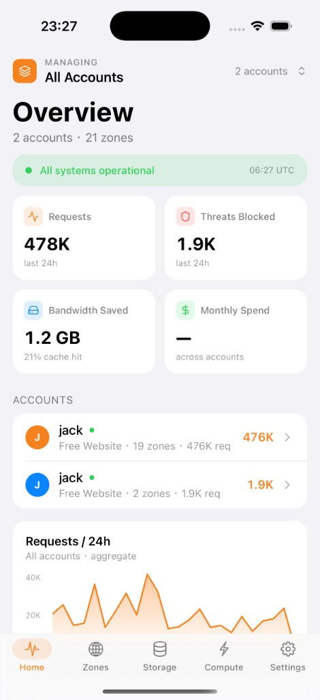
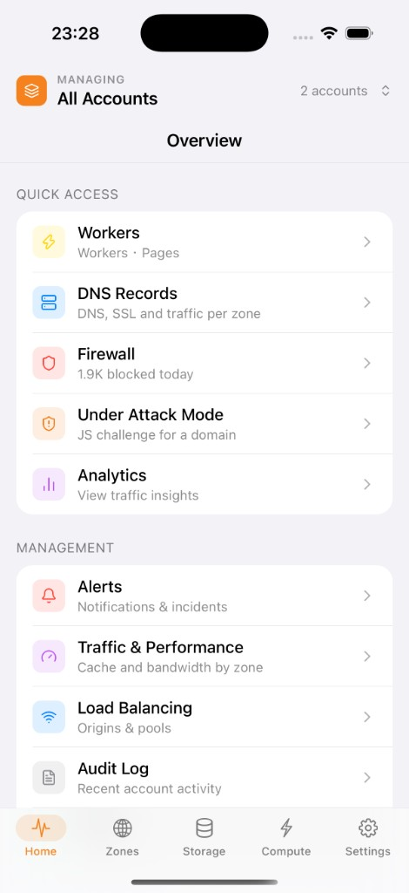
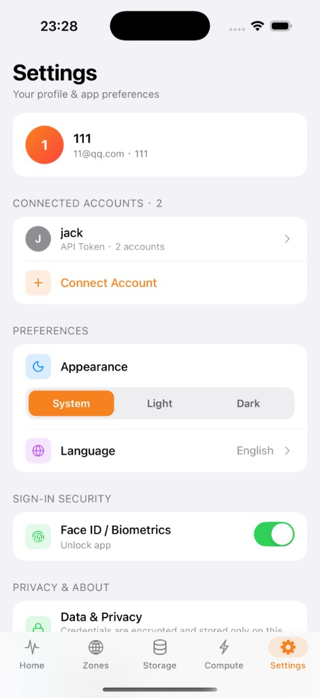
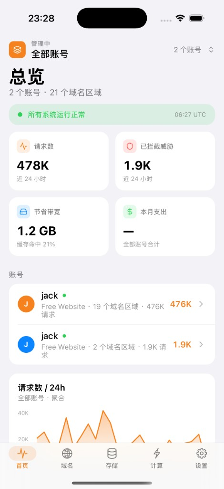
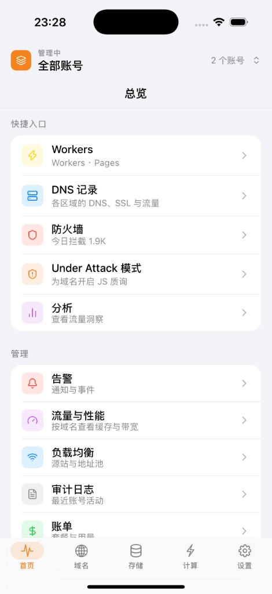
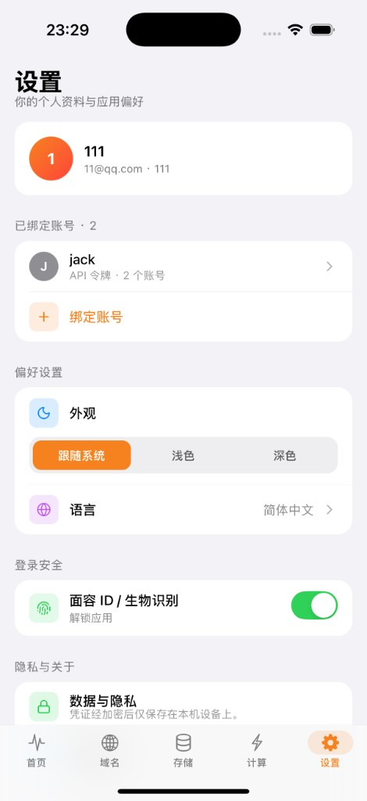

# Opsflare

[简体中文](README.zh-Hans.md)

Unofficial Cloudflare multi-account mobile client for iOS and Android, built
with Expo and React Native. Source:
[github.com/bearBoy80/opsflare](https://github.com/bearBoy80/opsflare).

Opsflare is an independent project. It is not affiliated with, endorsed by, or
sponsored by Cloudflare, Inc. Do not use Cloudflare's name, logo, or wordmark
in a way that implies an official product.

Status: usable for day-to-day account work. API-token sign-in works with a
plain checkout. "Sign in with Cloudflare" is optional: deploy `oauth-relay/`
first, copy its public URL, then register a Cloudflare OAuth client that
uses that URL.

## Features

- Local app account with password or biometric unlock
- Sign in with a scoped API token, or with Cloudflare OAuth when configured
- Multi-account Home, Zones, Storage, and Compute tabs
- DNS, cache, SSL, firewall, R2, KV, D1, Workers, and Pages screens
- English and Simplified Chinese interface

## Screenshots

| Home | Shortcuts | Settings |
| --- | --- | --- |
|  |  |  |
|  |  |  |

## Development

```sh
cp .env.example .env
npm install
npm start
```

Leave `.env` empty to hide "Sign in with Cloudflare". API-token sign-in and
the test suite do not need OAuth. To enable OAuth, finish
[OAuth setup](#oauth-setup) before `npm start`. From the Expo prompt, press
`i` for the iOS Simulator or `a` for an Android emulator (`npm run ios` /
`npm run android`).

```sh
npm test -- --runInBand
npx tsc --noEmit
```

Tests use Jest, `jest-expo`, and React Native Testing Library. Place tests in a
nearby `__tests__/` directory and name them `*.test.ts` or `*.test.tsx`.

## OAuth setup

Cloudflare rejects private-use redirect URIs, so OAuth cannot talk to
`opsflare://` directly. Each person (or each published build) deploys the
`oauth-relay/` Worker in this repo, then points a Cloudflare OAuth client at
that Worker. The Worker 302s the authorization response to
`opsflare://oauth/callback`.

Do the steps in this order. The client cannot be created until the Worker
URL exists.

1. **Deploy `oauth-relay/`** and copy the printed origin. Full commands and
   client settings are in [`oauth-relay/README.md`](oauth-relay/README.md).

   ```sh
   cd oauth-relay
   npm install
   npx wrangler login
   npm run deploy
   ```

   The redirect URI is the origin plus `/callback`, for example
   `https://opsflare-oauth-relay.<subdomain>.workers.dev/callback`.

2. **Create a Cloudflare OAuth client** at Dashboard → **Manage account** →
   **OAuth clients**. Set the redirect URL to the `/callback` address from
   step 1. Use response type `code`, grant types `authorization_code` and
   `refresh_token`, and token authentication method `none` (public PKCE
   client). Copy the **Client ID**.

3. **Configure the app** in `.env`:

   ```
   EXPO_PUBLIC_CF_OAUTH_CLIENT_ID=<client id>
   EXPO_PUBLIC_CF_OAUTH_REDIRECT_URI=https://<your-worker>/callback
   ```

   The redirect URI must match the dashboard value byte for byte. Restart
   Metro after saving.

The Worker is stateless and holds no secrets. The PKCE verifier stays on the
device; token exchange happens between the app and
`https://dash.cloudflare.com/oauth2/token`.

Do not commit `.env` or a shared production client id. Forks and
contributors should deploy their own relay and register their own client.

## Architecture

- `app/` contains Expo Router layouts and screens.
- `src/auth/` owns the local account and authentication state machine.
- `src/cloudflare/` talks to the Cloudflare REST and GraphQL APIs.
- `src/components/` contains shared UI.
- `src/theme/` is the only source for application color tokens.
- `oauth-relay/` is the Worker you deploy before OAuth. It bounces the
  Cloudflare callback into `opsflare://oauth/callback`.

First launch follows a four-step onboarding flow. After setup, every cold
start and foreground return requires password or biometric unlock before the
five-tab shell mounts.

Local passwords use a salted SHA-256 verifier stored through
`expo-secure-store`. Never place passwords, Cloudflare credentials, or API
tokens in source, AsyncStorage, SQLite, fixtures, or logs.

## License

MIT. See `LICENSE`.
